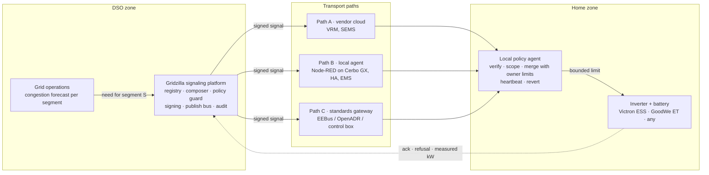

# Gridzilla

**A grid signaling platform for grid-serving storage.**
Gridzilla is the DSO's monster. It stomps on grid congestion by asking home batteries to charge or discharge, but every house keeps it on a leash.

Built at the Energy Bridge Critical Infrastructure Hackathon, Vienna, 23–25 October 2026, for the *Grid-Serving Storage* challenge (see `docs/Challenge-Grid-Serving-Storage_EN.docx`).

Team: Mathew, Peter, Matthew.

## The idea in one paragraph

A distribution system operator (DSO) sees a transformer or feeder about to overload. Today its only tools are curtailing PV or building more grid. Gridzilla gives it a third tool: a **signed, bounded, segment-scoped signal** that tells the batteries in that segment how much the home may import or export for a limited time. The signal reaches Victron, GoodWe and any other system through three vendor-agnostic paths, and always ends in a **local policy agent** that merges it with the owner's own limits before anything is written to the inverter. The DSO never gets raw control of a device.

## Architecture

Full architecture page with diagrams, signal model, threat model and demo script: [`docs/architecture.html`](docs/architecture.html)
(live copy: https://claude.ai/artifact/EKMwWEAfzeujPU5DGsgVpi)



## The signal

An envelope at the grid connection point, never a device setpoint.

| Mode | When | Effect |
|---|---|---|
| `ABSORB` | PV surplus congestion | lower export limit, allow grid charging |
| `SUPPORT` | load peak congestion | lower import limit, battery covers the house |
| `RELEASE` | event over | owner mode resumes (also on expiry or lost heartbeat) |

Fields: `segment_id`, `mode`, `import_limit_kw`, `export_limit_kw`, `valid_from`, `valid_to`, `ramp_s`, `seq`, `issued_at`, `signature`.

## Security principles

1. Every signal is signed by the platform and verified at the device, end to end, even through a vendor cloud.
2. Signals are limits with a bounded duration, never setpoints. The platform's policy guard caps magnitude, duration and frequency.
3. The owner's limits (minimum SoC, max current, opt-out) always win. The merge can only tighten the DSO envelope.
4. Fail-safe revert: the agent must keep hearing heartbeats to stay in grid-serving mode.
5. Outbound-only connections from the home. No inbound listeners, no port forwarding.
6. Replay protection through sequence numbers and short validity windows.
7. Randomized ramps so no signal can create a synchronized step on the grid.
8. The DSO sees aggregate segment data, not household behaviour.

## Reference installation and demo

The reference plant is a Victron ESS system (Cerbo GX, MultiPlus-II, MPPT, battery, grid meter) on VRM. The local policy agent runs as a Node-RED flow on Venus OS. Demo script: valid signal, refused signal below minimum SoC, replayed signal, platform outage with fail-safe revert. See the architecture page for the Victron and GoodWe mappings.

## Repository layout

```
docs/architecture.html   architecture page (diagrams, signal, threats, demo script)
docs/Challenge-*.docx    the original challenge text
```

Code for the mock platform and the Node-RED agent flow will land here during the hackathon.
