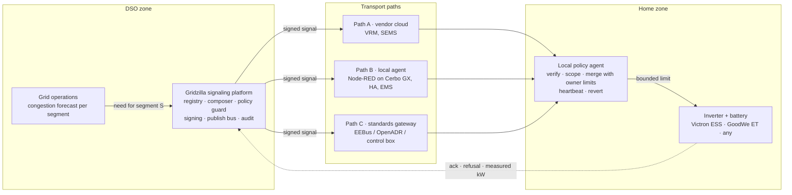

# Gridzilla

**A grid signaling platform for grid-serving storage.**
Gridzilla is the DSO's monster. It stomps on grid congestion by asking home batteries to charge or discharge, but every house keeps it on a leash.

Built at the Energy Bridge Critical Infrastructure Hackathon, Vienna, 23–25 October 2026, for the *Grid-Serving Storage* challenge (see `docs/Challenge-Grid-Serving-Storage_EN.docx`).

Team: Mathew, Peter, Matthew.

## The problem

**Home batteries are now the largest storage fleet in Europe, and the grid operator cannot see or use a single one of them.** In a crisis everyone gets cut equally, including the houses that could have ridden through.

- **Slovakia:** no DSO sends signals to home storage. The only flexibility pilot (SEPS, Nano Energies, SSD, 2022–2023) served the TSO's ancillary services, not the street transformer.
- **Germany:** §14a EnWG (2024) lets a DSO dim new batteries, wallboxes and heat pumps to 4.2 kW. Grid charging only, never discharge, never pre-charge. Used in under 1 % of hours.
- **Ukraine:** almost 3 GWh of batteries installed in 2025, mostly in homes. Ukrenergo publishes outage queues over Telegram and people charge by hand before their slot. Not one battery is coordinated with the operator.

**Pitch in thirty seconds.** A street transformer is hit, or the country is short of power, and the operator starts cutting streets. On that street sit seventy kilowatt hours of batteries that nobody told to charge last night. Gridzilla is the signal that fills them before the event, drains them while the grid is short, and rations them while the street is dark. It works on Victron, GoodWe and anything else, it never gives the operator raw control, and every house keeps it on a leash.

**What it is worth.** Per street little, per penetration a lot: fifteen batteries at 5 kW on a sixty-house street are about 30 % of a 250 kVA transformer for two to three hours. In a crisis the unit is hours of avoided outage, not kilowatts. For the DSO the money is in deferred transformer upgrades and less curtailment. EVs come next: same signals, one new registry field for where the car is plugged in.

## The idea in one paragraph

A distribution system operator (DSO) sees a transformer or feeder about to overload. Today its only tools are curtailing PV or building more grid. Gridzilla gives it a third tool: a **signed, bounded, segment-scoped signal** that tells the batteries in that segment how much the home may import or export for a limited time. The signal reaches Victron, GoodWe and any other system through three vendor-agnostic paths, and always ends in a **local policy agent** that merges it with the owner's own limits before anything is written to the inverter. The DSO never gets raw control of a device.

## Architecture

Full architecture page with diagrams, signal model, threat model and demo script: [`docs/architecture.html`](docs/architecture.html)
(live copy: https://claude.ai/artifact/EKMwWEAfzeujPU5DGsgVpi)



## The signals

A signal is an envelope at the grid connection point, never a device setpoint.

**Everyday case: congestion on a street transformer**

| Mode | When | Effect |
|---|---|---|
| `ABSORB` | PV surplus congestion | lower export limit, allow grid charging |
| `SUPPORT` | load peak, or grid up but short of generation | **import cap** ("take 3 kW only"): houses run on their batteries; and when the street needs more, **forced feed-in** ("give at least 2 kW"): batteries export to the neighbours, paid per kWh |
| `RELEASE` | event over | owner mode resumes (also on expiry or lost heartbeat) |

**Crisis case: outage, destroyed transformer, load shedding**

| Mode | When | Effect | Realistic today |
|---|---|---|---|
| `PREPARE` | warning: forecast attack, storm, planned shedding window | charge to a target SoC by a deadline, staggered and power-capped so the charging itself does not overload the transformer or deepen an upstream deficit | yes, people in Ukraine do it by hand from the outage calendar |
| `SUPPORT` | grid up but short | as above; this is "discharge when energy is valuable", and it needs no export at all | yes, this is what demand flexibility services pay for |
| `STRETCH` | street dead, expected restoration time known | each house islands on its own inverter; the agent rations discharge and sheds heat pump, EV charger and boiler to last until restoration | partly, needs a comms path that survives the outage (GX LTE) or a cached schedule |
| `RECOVER` | transformer replaced | staggered recharge so 70 kWh of batteries do not refill on top of cold-load pickup | yes |

**Segments are a tree.** A signal targets the level where the constraint is: street transformer (`tf:mauer-2`), 22 kV feeder (`feeder:liesing-3`), 110/22 kV substation Wien Süd (`sub:wien-sued`) or region (`region:at`). Batteries in Atzgersdorf can relieve a feeder or substation that also serves Mauer, by feeding in through their own transformer in reverse, but they cannot relieve Mauer's own street transformer. The agent accepts only signals for nodes it sits under.

A dead transformer cannot be fed from the street: inverters must disconnect from a dead grid and there is no grid-forming anchor. A street island from home batteries is the future slide, not the product.

Fields: `segment`, `mode`, `import_max_kw`, `export_max_kw`, `export_min_kw` (forced feed-in), `charge_max_kw`, `discharge_max_kw`, `target_soc`, `valid_from`, `valid_to`, `ramp_s`, `seq`, `issued_at`, `note`. The payload is wrapped in a signed envelope (`v`, `kid`, `payload`, `sig`). Full definition: [`protocol/PROTOCOL.md`](protocol/PROTOCOL.md).

`PREPARE` and `STRETCH` are signed schedules the agent executes offline if the link dies. Live heartbeats apply to the congestion limits only, where losing contact must revert to owner mode.

## Enforcement and settlement

A DSO will not pay for a promise, and a household can switch any agent off. Gridzilla solves that by measuring where the household cannot touch and paying only for what the meter proves.

Every signal is a **limit at the connection point**: a ceiling on import, a ceiling on export, or a floor on export. Each is a yes/no check per 15-minute interval on the DSO's own smart meter. No baseline, no counterfactual, nothing to inflate.

1. **Meter is the judge.** Settlement runs on the DSO smart meter, never on inverter telemetry. Agent acks are for real-time awareness and audit.
2. **No ack, no pay.** The agent signs acknowledgements with a device key. Switched off or tampered with, the signatures stop.
3. **Compliance gates the perks.** Availability fee and the relaxed feed-in limit are paid against measured compliance. Three strikes a year and the household leaves the program and loses the connection terms that got it in.
4. **The DSO's existing hammer.** Smart meters already have remote disconnect and load limiting. Program members are exempt from shedding only while the meter shows compliance.

Cheating on `PREPARE` or `STRETCH` only hurts the cheater. Cheating on the import cap or forced feed-in is visible at the meter and simply unpaid, with the strike and disconnect backstop behind it.

**Household incentives:** connection and feed-in rights (join the program, get connected or get a higher feed-in limit), an availability fee per kW per year paid against compliance, payment per kWh delivered under forced feed-in, and in a crisis a full battery before the outage, a shorter shedding queue and priority restoration. **Protection:** owner-set minimum SoC the DSO can never touch, a cap on cycles per year, opt-out from the app, aggregate data only.

## Security principles

1. Every signal is signed by the platform and verified at the device, end to end, even through a vendor cloud.
2. Signals are limits with a bounded duration, never setpoints. The platform's policy guard caps magnitude, duration and frequency.
3. The owner's limits (minimum SoC, max current, opt-out) always win. The merge can only tighten the DSO envelope.
4. Fail-safe revert: the agent must keep hearing heartbeats to stay in grid-serving mode.
5. Outbound-only connections from the home. No inbound listeners, no port forwarding.
6. Replay protection through sequence numbers and short validity windows.
7. Randomized ramps so no signal can create a synchronized step on the grid.
8. The DSO sees aggregate segment data, not household behaviour.
9. `PREPARE` and `STRETCH` can only raise target SoC or lower discharge. `SUPPORT` is the only signal that spends energy and it is capped in depth and duration, so a compromised platform cannot drain the street the night before a strike.

## Reference installation and demo

The reference plant is a Victron ESS system (Cerbo GX, MultiPlus-II, MPPT, battery, grid meter) on VRM. The local policy agent runs as a Node-RED flow on Venus OS. Demo script: valid signal, refused signal below minimum SoC, replayed signal, platform outage with fail-safe revert. See the architecture page for the Victron and GoodWe mappings.

## Quickstart (the whole stack on one laptop)

```bash
# 1. broker: the public one is mqtts://mqtt.victronlab.sk:8883 (TLS, credentials in the vault: 'gridzilla mqtt - gz-platform' / 'gz-devices')
#    local fallback for offline work:
brew install mosquitto && /opt/homebrew/opt/mosquitto/sbin/mosquitto -p 1883

# 2. DSO platform + dashboard  ->  http://localhost:8080
python3 -m venv .venv && .venv/bin/pip install -r platform/requirements.txt
cd platform && ../.venv/bin/python gridzilla.py
#    with the advisor: copy platform/.env.example to platform/.env, set GZ_LLM_KEY (gateway token), then
./run.sh
#    The advisor talks ONLY to the LLM gateway on :9000. The model server itself must not be reachable.

# 3. four simulated houses (two villages on one 22 kV feeder), two with EV chargers
cd agent && npm install && node sim-agent.js          # GZ_SPEED=1 (default) = 1 simulated minute per second; use 2-4 to see SoC move fast
#    public broker: GZ_BROKER=mqtts://mqtt.victronlab.sk:8883 GZ_MQTT_USER=gz-devices GZ_MQTT_PASS=... node sim-agent.js

# 4. send a signal from the dashboard, or:
curl -X POST localhost:8080/api/signal -H 'Content-Type: application/json' \
  -d '{"segment":"feeder:liesing-3","mode":"SUPPORT","import_max_kw":3,"export_min_kw":2,"duration_min":120}'
```

**On Windows** (PowerShell), the same steps:

```powershell
# 1. broker (or run mosquitto in Docker)
winget install EclipseFoundation.Mosquitto
& "C:\Program Files\mosquitto\mosquitto.exe" -p 1883

# 2. platform
py -m venv .venv; .venv\Scripts\pip install -r platform\requirements.txt
cd platform; ..\.venv\Scripts\python gridzilla.py

# 3. simulated houses
cd agent; npm install; node sim-agent.js
```

The platform generates its Ed25519 key on first start (`platform/keys/`, private key is git-ignored). Agents fetch the public key once and pin it. Each agent generates its own device key and registers its public key with the platform. Simulated agents remember the last accepted `seq` in `agent/keys/<device>.seq`; if you reset the platform (delete `platform/state.json`), delete those files too, or every new signal is refused as `stale_seq`.

## Repository layout

```
protocol/                PROTOCOL.md + JSON Schemas: envelope, signal, ack. Frozen.
platform/gridzilla.py    DSO platform: registry, policy guard, Ed25519 signing, MQTT, heartbeat, dashboard, advisor
platform/weather.py      live weather (Open-Meteo) and official warnings (MeteoAlarm, GeoSphere) for /api/weather and the autopilot
platform/registry.yaml   grid tree (region > substation > feeder > transformer) and the devices in the program
platform/static/         operator dashboard
agent/sim-agent.js       simulated houses speaking the protocol (verify, scope, merge, ack, watchdog, revert)
agent/nodered/           function-node sources and wiring for the real Cerbo GX agent
docs/architecture.html   architecture page: diagrams, signals, threat model, enforcement, demo script
docs/implementers.md     how GoodWe, Huawei, SMA, Fronius, Sungrow, SolarEdge, Tesla, Home Assistant, EVCC, EEBus, OpenADR, OCPP implement the signal
docs/plan-saturday.md    who does what on the build day, demo script, cut order
docs/Challenge-*.docx    the original challenge text
```

## DeepSeek autopilot and envelope curves

The platform runs the grid on its own. Every 10 s it forecasts each street transformer 90 grid minutes ahead. When one is forecast past ±85 % of its rating, or the operator sets a standing warning, it asks DeepSeek (any OpenAI-compatible endpoint, via the LLM gateway) for one signal or none. For `ABSORB` and `SUPPORT` the platform attaches a **dynamic operating envelope**: a per-house import or export ceiling for every 15-minute slot, computed from the forecast headroom of each transformer (see `protocol/PROTOCOL.md`, *Envelope curves*). The deterministic policy guard checks the result. If it passes, it is signed and sent with no human in the loop, within the autopilot's own brakes: a 30-minute cooldown per segment and at most 12 signals per grid day. It never releases a signal an operator sent by hand.

Modes on the dashboard: **Autonomous** (default when `GZ_LLM_URL` is set, or `GZ_AUTOPILOT=auto`), **Operator approves** (one click per decision), **Off**. The dashboard shows the control loop live (sense → trigger → DeepSeek → guard → sign → houses), every decision with DeepSeek's rationale, and the envelope curve against the measured power of the program houses. Two demo scenarios on the dashboard scale the houses outside the program: *cold evening* (load ×1.2) and *sunny noon* (PV ×5); a third, `live-weather`, uses the real forecast (see *Live weather and warnings*).

The simulation clock runs 60× real time (`GZ_SIM_X=60`, matching `sim-agent.js`); all autopilot and envelope times are grid minutes.

### If the AI dies, the grid doesn't notice

When DeepSeek is down, slow or answers garbage, fixed safety rules (`platform/fallback.py`) decide instead, for the same target the planner chose, and their proposal goes through the same guard, brakes, cooldowns and operator hand-off as DeepSeek's:

- import peak under the target → `SUPPORT` on the target with its per-transformer envelope; flat `import_max_kw` = the tightest slot (never below the policy floor); duration = until the forecast is back under the release threshold, at most the policy window
- PV backflow → `ABSORB` with the envelope's export ceiling
- an autopilot signal no longer needed → `RELEASE`
- anything else (operator note, `PREPARE`/`STRETCH`/`RECOVER`, no program houses online under the target) → no action, history shows "rules: needs operator"

The LLM call times out after `GZ_LLM_TIMEOUT_S` real seconds (default 15). After two failures in a row a circuit breaker skips DeepSeek for 60 real seconds, then probes it; one good answer closes it. Without `GZ_LLM_URL` the autopilot can still run on the rules alone. Pitch demo: `curl -X POST localhost:8080/api/demo/ai/down` (no LLM call while down) and `.../api/demo/ai/up`. `/api/state` → `autopilot.brain` (`ai` | `rules`, who decided last) and `autopilot.ai` (health, failures, breaker); every history entry has `source`.

## The pitch

`docs/PRESENTATION.md`: the 12-minute run of show, the full script per slide, the demo clicks, the questions and answers, and the pre-flight checklist. Deck in `docs/Gridzilla-pitch.pptx`, jingle in `docs/Gridzilla-jingle.m4a`.

## Flattening: the monster's diet (SHAPE)

Under the DeepSeek autopilot a deterministic planner (`platform/flatten.py`) flattens every street every day: a
water-filling plan per transformer, two per-slot ceilings per house for the next 24 grid hours, sent as one `SHAPE`
signal per feeder on `gridzilla/shape/<segment>` and renewed every two grid hours. Cars plugged in at dinner trickle
through the peak and charge at night, batteries eat the slice above the level, the noon PV surplus goes into the
batteries instead of the feeder. Owner limits still win; event signals ride on top. The board's **Flattening** tab shows
the plan for the city, a substation, a feeder or a street: without Gridzilla, with the plan, the level, and what was
eaten. `GET /api/flatten?node=` returns it, `POST /api/shape/off|on` pauses or resumes the plan.

## Live weather and warnings

`platform/weather.py` fetches the real forecast every 15 minutes (`GZ_WEATHER_REFRESH_S=900`) and serves it at `GET /api/weather` (current values, 48 hours, official warnings, a one-sentence summary, and `grid_view`: the next 24 grid hours mapped onto the simulation clock). DeepSeek gets the summary, the next 6 grid hours and the active warnings in its context.

- Forecast: [Open-Meteo](https://open-meteo.com), global, no key. The free API is for non-commercial use; a production deployment would use their paid commercial endpoint, set with `GZ_WEATHER_URL`.
- Warnings: MeteoAlarm (EUMETNET, ~38 European countries) for `GZ_WEATHER_COUNTRY` (default `AT`), filtered to the region of the location by EMMA_ID (`GZ_WEATHER_AREA`, `AT923` for the default Wien-Liesing) or else by name; the feed has no area shapes, so if the name matches no area, the country list is kept and the summary calls those warnings elsewhere in the country. In Austria, GeoSphere Austria's coordinate-based warnings are added on top.
- Location: `GZ_WEATHER_LAT`, `GZ_WEATHER_LON`, `GZ_WEATHER_NAME`; otherwise the top registry node with `lat`/`lon`; otherwise Wien-Liesing.
- `POST /api/scenario/live-weather` lets the weather drive the houses outside the program: load ×(1 + 0.016 per degree of apparent temperature below 15 °C, max 1.6), PV × measured sun / clear-sky sun. The default scenario does not change.
- `GZ_WEATHER=0` turns it off (offline demo). On an outage the last good data is served with `stale: true`; the platform never waits for it.
- Tests (offline, recorded responses): `cd platform && python3 -m unittest discover -s tests`
