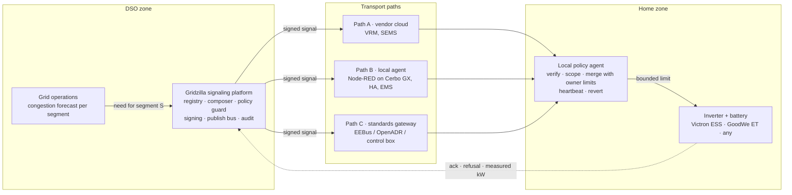

# Gridzilla

**A grid signaling platform for grid-serving storage.**
Gridzilla is the DSO's monster. It stomps on grid congestion by asking home batteries to charge or discharge, but every house keeps it on a leash.

Built at the Energy Bridge Critical Infrastructure Hackathon, Vienna, 23–25 October 2026, for the *Grid-Serving Storage* challenge (see `docs/Challenge-Grid-Serving-Storage_EN.docx`).

Team: Mathew, Peter, Matthew.

## The problem

**Home batteries are now the largest storage fleet in Europe, and the grid operator cannot see or use a single one of them.** In a crisis everyone gets cut equally, including the houses that could have ridden through.

- **Slovakia:** no DSO sends signals to home storage. The only flexibility pilot (SEPS, Nano Energies, SSD, 2022–2023) served the TSO's ancillary services, not the street transformer.
- **Germany:** §14a EnWG (2024) lets a DSO dim new batteries, wallboxes and heat pumps to 4.2 kW. Grid charging only, never discharge, never pre-charge. Used in under 1 % of hours.
- **Ukraine:** almost 3 GWh of batteries installed in 2025, mostly in homes. Ukrenergo publishes outage queues over Telegram and people charge by hand before their slot. Not one battery is coordinated with the operator.

**Pitch in thirty seconds.** A street transformer is hit, or the country is short of power, and the operator starts cutting streets. On that street sit seventy kilowatt hours of batteries that nobody told to charge last night. Gridzilla is the signal that fills them before the event, drains them while the grid is short, and rations them while the street is dark. It works on Victron, GoodWe and anything else, it never gives the operator raw control, and every house keeps it on a leash.

**What it is worth.** Per street little, per penetration a lot: fifteen batteries at 5 kW on a sixty-house street are about 30 % of a 250 kVA transformer for two to three hours. In a crisis the unit is hours of avoided outage, not kilowatts. For the DSO the money is in deferred transformer upgrades and less curtailment. EVs come next: same signals, one new registry field for where the car is plugged in.

## The idea in one paragraph

A distribution system operator (DSO) sees a transformer or feeder about to overload. Today its only tools are curtailing PV or building more grid. Gridzilla gives it a third tool: a **signed, bounded, segment-scoped signal** that tells the batteries in that segment how much the home may import or export for a limited time. The signal reaches Victron, GoodWe and any other system through three vendor-agnostic paths, and always ends in a **local policy agent** that merges it with the owner's own limits before anything is written to the inverter. The DSO never gets raw control of a device.

## Architecture

Full architecture page with diagrams, signal model, threat model and demo script: [`docs/architecture.html`](docs/architecture.html)
(live copy: https://claude.ai/artifact/EKMwWEAfzeujPU5DGsgVpi)



## The signals

A signal is an envelope at the grid connection point, never a device setpoint.

**Everyday case: congestion on a street transformer**

| Mode | When | Effect |
|---|---|---|
| `ABSORB` | PV surplus congestion | lower export limit, allow grid charging |
| `SUPPORT` | load peak, or grid up but short of generation | **import cap** ("take 3 kW only"): houses run on their batteries; and when the street needs more, **forced feed-in** ("give at least 2 kW"): batteries export to the neighbours, paid per kWh |
| `RELEASE` | event over | owner mode resumes (also on expiry or lost heartbeat) |

**Crisis case: outage, destroyed transformer, load shedding**

| Mode | When | Effect | Realistic today |
|---|---|---|---|
| `PREPARE` | warning: forecast attack, storm, planned shedding window | charge to a target SoC by a deadline, staggered and power-capped so the charging itself does not overload the transformer or deepen an upstream deficit | yes, people in Ukraine do it by hand from the outage calendar |
| `SUPPORT` | grid up but short | as above; this is "discharge when energy is valuable", and it needs no export at all | yes, this is what demand flexibility services pay for |
| `STRETCH` | street dead, expected restoration time known | each house islands on its own inverter; the agent rations discharge and sheds heat pump, EV charger and boiler to last until restoration | partly, needs a comms path that survives the outage (GX LTE) or a cached schedule |
| `RECOVER` | transformer replaced | staggered recharge so 70 kWh of batteries do not refill on top of cold-load pickup | yes |

**Segments are a tree.** A signal targets the level where the constraint is: street transformer (`tf:mosovce-2`), 22 kV feeder (`feeder:turiec-3`), 110/22 kV substation (`sub:martin`) or region (`region:sk`). Batteries in Blatnica can relieve a feeder or substation that also serves Mošovce, by feeding in through their own transformer in reverse, but they cannot relieve Mošovce's own street transformer. The agent accepts only signals for nodes it sits under.

A dead transformer cannot be fed from the street: inverters must disconnect from a dead grid and there is no grid-forming anchor. A street island from home batteries is the future slide, not the product.

Fields: `segment_id`, `mode`, `import_max_kw`, `export_max_kw`, `export_min_kw` (forced feed-in), `target_soc`, `valid_from`, `valid_to`, `ramp_s`, `seq`, `issued_at`, `signature`.

`PREPARE` and `STRETCH` are signed schedules the agent executes offline if the link dies. Live heartbeats apply to the congestion limits only, where losing contact must revert to owner mode.

## Enforcement and settlement

A DSO will not pay for a promise, and a household can switch any agent off. Gridzilla solves that by measuring where the household cannot touch and paying only for what the meter proves.

Every signal is a **limit at the connection point**: a ceiling on import, a ceiling on export, or a floor on export. Each is a yes/no check per 15-minute interval on the DSO's own smart meter. No baseline, no counterfactual, nothing to inflate.

1. **Meter is the judge.** Settlement runs on the DSO smart meter, never on inverter telemetry. Agent acks are for real-time awareness and audit.
2. **No ack, no pay.** The agent signs acknowledgements with a device key. Switched off or tampered with, the signatures stop.
3. **Compliance gates the perks.** Availability fee and the relaxed feed-in limit are paid against measured compliance. Three strikes a year and the household leaves the program and loses the connection terms that got it in.
4. **The DSO's existing hammer.** Smart meters already have remote disconnect and load limiting. Program members are exempt from shedding only while the meter shows compliance.

Cheating on `PREPARE` or `STRETCH` only hurts the cheater. Cheating on the import cap or forced feed-in is visible at the meter and simply unpaid, with the strike and disconnect backstop behind it.

**Household incentives:** connection and feed-in rights (join the program, get connected or get a higher feed-in limit), an availability fee per kW per year paid against compliance, payment per kWh delivered under forced feed-in, and in a crisis a full battery before the outage, a shorter shedding queue and priority restoration. **Protection:** owner-set minimum SoC the DSO can never touch, a cap on cycles per year, opt-out from the app, aggregate data only.

## Security principles

1. Every signal is signed by the platform and verified at the device, end to end, even through a vendor cloud.
2. Signals are limits with a bounded duration, never setpoints. The platform's policy guard caps magnitude, duration and frequency.
3. The owner's limits (minimum SoC, max current, opt-out) always win. The merge can only tighten the DSO envelope.
4. Fail-safe revert: the agent must keep hearing heartbeats to stay in grid-serving mode.
5. Outbound-only connections from the home. No inbound listeners, no port forwarding.
6. Replay protection through sequence numbers and short validity windows.
7. Randomized ramps so no signal can create a synchronized step on the grid.
8. The DSO sees aggregate segment data, not household behaviour.
9. `PREPARE` and `STRETCH` can only raise target SoC or lower discharge. `SUPPORT` is the only signal that spends energy and it is capped in depth and duration, so a compromised platform cannot drain the street the night before a strike.

## Reference installation and demo

The reference plant is a Victron ESS system (Cerbo GX, MultiPlus-II, MPPT, battery, grid meter) on VRM. The local policy agent runs as a Node-RED flow on Venus OS. Demo script: valid signal, refused signal below minimum SoC, replayed signal, platform outage with fail-safe revert. See the architecture page for the Victron and GoodWe mappings.

## Repository layout

```
docs/architecture.html   architecture page (diagrams, signal, threats, demo script)
docs/Challenge-*.docx    the original challenge text
```

Code for the mock platform and the Node-RED agent flow will land here during the hackathon.
